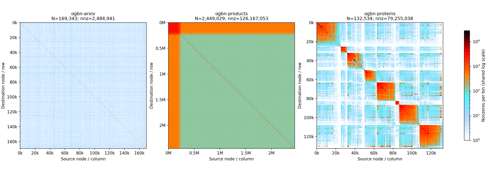

# OGB 扩展实验：数据和缩略图已准备，正式计时等待空闲 GPU

实验范围：ogbn-arxiv、ogbn-products、ogbn-proteins × F=64/128/256/512，共 12 组。
按用户指示，暂不测 ogbn-mag，也不测 ogbn-papers100M。

对照仍是原始 Acc（FP32 X）与每个 TC block 内反量化 INT4 X 的版本；另测 Acc(X̂) 作为同数值对照。反量化在 kernel 内计时，量化和上传在计时外。

## 数据

| 数据集 | 节点数 | 实际测试 A 的 nnz | 基础特征维度 |
|---|---:|---:|---:|
| ogbn-arxiv | 169,343 | 2,484,941 | 128 |
| ogbn-products | 2,449,029 | 126,167,053 | 100 |
| ogbn-proteins | 132,534 | 79,255,038 | 8（从边特征构造） |

arxiv/products 复用之前同一份 CSR 和真实节点特征。proteins 取双向单位权邻接并添加单位自环；X 为每个节点相邻边 8 维属性的均值。指定维度通过取前 F 列或循环重复基础特征得到，不使用随机 X。来源和 SHA-256 见 `inputs.json`。

## A 缩略图



- [arxiv PNG](figures/ogbn-arxiv.png) / [PDF](figures/ogbn-arxiv.pdf)
- [products PNG](figures/ogbn-products.png) / [PDF](figures/ogbn-products.pdf)
- [proteins PNG](figures/ogbn-proteins.png) / [PDF](figures/ogbn-proteins.pdf)
- [三图总览 PDF](figures/ogbn_A_overview.pdf)

沿用用户提供的 `pic_heatmap.py` 的位置分桶与配色，改为直接从二进制 CSR 分块聚合，避免生成庞大的 MTX 文本。每图为 768×768 格，颜色表示格内非零项数量，空白表示 0；共用对数色标。不同图每格覆盖的节点数不同，因此颜色不是归一化边密度。计数之和均与 nnz 一致，见 `figures/metadata.json`。

## 正式运行状态

用户要求等空闲卡，已有的共享 GPU 临时试跑已放入 `discarded_shared_probe/`，不进入正式统计。

`bench/wait_run_acc_ogb.py` 会等到某张卡没有其他计算进程后启动；每 2 秒检查是否有其他计算进程进入，被干扰的组会中止、移入 `discarded_contention/` 并等待重测。不修改驱动，不占用/终止其他用户进程，也没有驱动级独占锁；不能保证发现轮询间极短的并发任务。

查看实时状态：

```bash
cat /home/shixingguo/work/GNN/tcc_spmm/results/acc_dequant_ogb/run_state.json
tail /home/shixingguo/work/GNN/tcc_spmm/results/acc_dequant_ogb/wait_run.log
```

`status=complete` 才表示 12 组测量与校验都完成。若 `status=failed`，应检查对应 stderr，不能将部分结果视为成功。
全部完成后自动生成 `report.md` 和 `summary.csv`；在此之前没有正式性能结果，不沿用旧数值填表。

若需要手动重新启动等待任务（先确认已有任务已经退出，避免重复）：

```bash
cd /home/shixingguo/work/GNN/tcc_spmm
python3 bench/wait_run_acc_ogb.py
```

图像复现：

```bash
PYTHONPATH="$PWD/build/plotdeps" /home/shixingguo/miniforge3/envs/gnn/bin/python bench/plot_acc_ogb_heatmaps.py
```

原始 Acc 已知同步竞争仍保留，正式输出会做三次抽样独立 CSR 校验和全输出 Acc(X̂) 对照，不把检查通过解释为已修复竞争。
